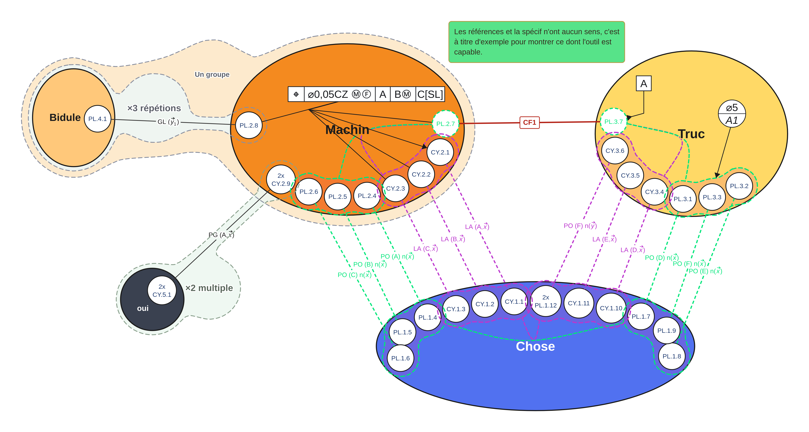

# Graphe des contacts

Un outil visuel pour représenter un assemblage mécanique par ses **pièces, ses
surfaces et ses contacts**, puis construire des conditions fonctionnelles et
leurs cycles.

Il utilise les **méthodes de graphes de l’Université de Bordeaux** pour la
représentation et l’étude des assemblages mécaniques. Il est destiné notamment
aux étudiants qui souhaitent construire des graphes pour leurs exercices,
projets ou comptes rendus.

> Ce projet est un outil indépendant : cette référence aux méthodes de
> l’Université de Bordeaux ne constitue pas une validation ou une affiliation
> officielle de l’application. Pour les conventions et la validation d’un
> exercice, se référer aux consignes de l’enseignant.

## Aperçu

## Ce que permet l’outil

- Créer et déplacer des pièces, représentées par des ellipses ; le bouton
  **Cercle parfait** rend une pièce circulaire en un clic. Leur nom accepte les
  **retours à la ligne**, se **déplace librement** (glisser) et se recentre par
  double-clic ou un bouton du panneau.
- Créer des liaisons avec leurs deux surfaces de contact.
- Choisir les types de surfaces et de liaisons, leurs couleurs et leurs
  répétitions ; masquer ou réafficher les symboles et noms des surfaces sans
  masquer les liaisons.
- Définir des axes et normales : `x`, `y`, `z` ou une direction personnalisée.
  La notation `u_123` affiche le suffixe « 123 » en indice.
- Organiser l’assemblage avec des groupes fonctionnels, des répétitions et des
  systèmes de référence.
- Réduire un groupe fonctionnel à une bulle pour simplifier la lecture.
- Créer des **CF — conditions fonctionnelles**, avec un nom libre, des surfaces
  existantes ou nouvelles et, si besoin, un point et une normale.
- Afficher sous chaque liaison son **torseur des actions transmissibles**
  {Tn1/n2}A = {u α ; v β ; w γ}A, avec des
  valeurs par défaut cohérentes avec l’axe choisi, modifiables une par une. La
  notation des composantes se règle dans **Paramètres** (u v w / α β γ par
  défaut, ou X Y Z / L M N).
- Annoter le graphe avec **ISO GPS** : références ISO (carré ou cercle partiel,
  rappel à coude) et **spécifications** — des cadres de tolérance ISO 1101 avec
  symboles de caractéristique, indications, indicateurs (Ⓜ maxi matière,
  Ⓔ gabarit…) et liens flèche ou trait simple vers les surfaces.
- Construire des cycles passant par les contacts et références, avec une seule
  CF par cycle.
- Afficher ou masquer les cycles, choisir leur couleur et gérer les CF en noir
  ou dans leur couleur.
- Compter les cycles non indépendants passant par chaque CF et calculer le nombre de cycles indépendants par le nombre cyclomatique.
- Exporter en **PDF multipage** : une vue d’ensemble, puis une page isolée par cycle dessiné à la main ; exporter aussi en PNG, SVG ou PowerPoint éditable.
- Ajouter des notes textuelles déplaçables et choisir un nom/emplacement au moment de l’export.
- Afficher une image de référence flottante pendant le travail.
- Enregistrer et rouvrir les graphes au format **JSON**.

## Installer et ouvrir l’outil

### Ce qu’il faut

Un ordinateur et un navigateur récent : **Microsoft Edge, Google Chrome ou
Mozilla Firefox**.

**Pas besoin de savoir programmer, de créer un compte GitHub ou d’installer Git,
Python ou Node.js.** L’outil fonctionne localement dans le navigateur, sans
installation supplémentaire.

### Étape 1 — Télécharger depuis GitHub

GitHub est le site qui héberge les fichiers du projet. Un « dépôt » est simplement
le dossier du projet sur ce site.

1. Ouvrir la page GitHub de ce projet, celle sur laquelle ce texte est affiché.
2. Revenir en haut de la page, au-dessus de la liste des fichiers.
3. Cliquer sur le bouton **Code**, généralement vert.
4. Dans le menu, cliquer sur **Download ZIP** (« Télécharger le ZIP »).
5. Attendre la fin du téléchargement. Le fichier se trouve généralement dans
   le dossier **Téléchargements** de l’ordinateur.

> Si le bouton **Code** n’apparaît pas, ouvrir l’onglet **Code** du dépôt ou revenir
> à la page principale du projet. Ne pas copier les fichiers un par un et ne pas
> télécharger seulement le fichier HTML.

### Étape 2 — Extraire le ZIP

Un ZIP est un dossier compressé : il faut **extraire son contenu** avant
d’utiliser l’application.

**Sous Windows :**

1. Ouvrir le dossier **Téléchargements**.
2. Faire un clic droit sur le fichier téléchargé, dont le nom se termine par
   `.zip`.
3. Choisir **Extraire tout…**, puis **Extraire**.
4. Déplacer le dossier extrait dans un endroit facile à retrouver, par exemple
   **Documents > Graphe-des-contacts**.

**Sous macOS :** double-cliquer sur le ZIP pour le décompresser, puis ranger le
dossier obtenu.

**Sous Linux :** utiliser l’option d’extraction du gestionnaire de fichiers.

Le dossier extrait peut porter un nom comme `graphe-des-contacts-main`. C’est
normal : `main` est le nom de la version principale du projet.

### Étape 3 — Ouvrir l’application

1. Ouvrir le dossier extrait.
2. Repérer **`index.html`**. Selon les réglages de Windows, il peut apparaître
   seulement sous le nom **`index`**, avec une icône de navigateur.
3. Double-cliquer dessus pour l’ouvrir.
4. Si nécessaire, faire un clic droit, choisir **Ouvrir avec**, puis sélectionner
   Edge, Chrome ou Firefox.

La barre d’adresse peut commencer par `file:///` : cela signifie que l’application
est ouverte depuis ton ordinateur.

**Garder tous les fichiers `.js` et `style.css` dans le même dossier que
`index.html`.** Ne pas ouvrir l’application directement dans le ZIP et ne pas
déplacer uniquement le fichier HTML.

Une fois téléchargé et extrait, l’outil peut être utilisé **sans connexion
Internet**.

## Faire son premier graphe

1. Cliquer sur **Nouvelle pièce**, saisir un nom et créer la pièce.
2. Recommencer pour créer une deuxième pièce.
3. Avec **Déplacer**, glisser les pièces pour organiser le graphe.
4. Cliquer sur **Nouvelle liaison**, puis effectuer un **Ctrl+clic** sur chacune
   des deux pièces.
5. Choisir le type de liaison, les surfaces et les détails, puis valider.
6. Cliquer sur **Enregistrer** pour conserver une copie du graphe en JSON.

Le numéro de pièce sert à nommer automatiquement les surfaces. Par exemple,
`CY.1.1` désigne une surface cylindrique de la pièce 1. Il n’est pas affiché
séparément sous le nom de la pièce.

Chaque surface peut aussi porter un **nom libre** (facultatif) : à la création
dans les fenêtres de liaison et de CF, par **double-clic sur la bulle**, ou avec
le champ **Nom libre** du panneau de la surface. Le texte est libre, sans
contrainte de format, et remplace la nomenclature automatique sur la bulle et
dans tous les exports. Laisser vide conserve le nom automatique ; le bouton
**↺ Nom automatique** du panneau efface le nom libre.

Le **nom de la pièce** accepte les retours à la ligne (champ multi-lignes à la
création et dans le panneau). Il est centré automatiquement dans la pièce ; le
glisser le déplace librement, et un **double-clic** sur le nom (ou le bouton
**Recentre le nom** du panneau) le remet à sa place centrée.

Le bouton **?** ouvre une aide plus détaillée dans l’application. Les spécifications ISO GPS peuvent recevoir des indications adjacentes non encadrées en haut à gauche du cadre ; une répétition de 1 n’affiche pas « 1x ».

## Groupes, CF et cycles

### Surfaces et liaisons

Le bouton **Surfaces** de la barre d’outils masque ou réaffiche les symboles et noms des surfaces. Les liaisons restent visibles et les surfaces sont dessinées derrière elles lorsqu’elles sont affichées. Le masquage est visuel : les surfaces restent sélectionnables.

### Organiser les pièces

- **Répétition** : choisir les pièces répétées, puis valider. Une CF peut être
  incluse ou exclue en cliquant sur une de ses surfaces pendant ce choix.
- **Fonctionnel** : choisir les pièces du groupe, puis valider. Il est aussi
  possible d’inclure un titre de répétition visible dans le contour, sans ajouter
  automatiquement les pièces de cette répétition.
- **Référence** : choisir les surfaces du système de référence. Leurs membres
  restent côte à côte dans chaque pièce ; les regroupements incompatibles sont
  signalés.

Les noms des groupes sont déplaçables. Les boutons **− / +** des groupes
fonctionnels permettent de les réduire ou de les développer.

### Créer une CF

1. Cliquer sur **CF**, puis sur deux pièces différentes. Les couleurs des deux
   pièces sont affichées dans la fenêtre.
2. Pour chaque extrémité, choisir une **surface existante** de la pièce ou une
   nouvelle surface (type + nombre de répétitions).
3. Saisir un nom : texte, nombre ou vide. Il doit être unique dans la feuille ;
   une seule CF sans nom est autorisée.
4. Ajouter si besoin un **point** (ex. A, O) et une **normale** (`x`, `y`, `z`
   ou une direction personnalisée comme `u_123`). Ces détails s’affichent sur le
   graphe avec le détail des liaisons.
5. Valider.

Une surface existante peut être partagée avec une liaison, mais jamais entre
deux CF. Supprimer une CF supprime ses surfaces devenues inutiles.

Le panneau **CF** liste toutes les conditions fonctionnelles de la feuille.
Il permet de les afficher en noir ou dans leur couleur, individuellement ou
toutes ensemble, sans effacer leur couleur enregistrée.

### Torseurs

Le bouton **Torseurs** de la barre affiche ou masque, sous chaque liaison, son
torseur des actions transmissibles. Les lignes sont les axes x, y, z ; la
première colonne donne les efforts / translations et la seconde les moments /
rotations. Les valeurs par défaut suivent le type de liaison et son axe ou sa
normale (ex. Pivot sur x → α = 0, Appui plan de normale z → w = γ = 0) et
chaque valeur se modifie dans le panneau de la liaison, avec un retour aux
valeurs par défaut en un clic. Le **point d’application** (A par défaut) se
modifie à côté des valeurs, dans le même panneau.

La **notation des composantes** se règle dans **Paramètres** : u v w et α β γ
par défaut, ou saisir X Y Z et L M N pour la notation classique. Les
composantes nulles restent des zéros et les valeurs déjà personnalisées sont
conservées.

### Compter les cycles

Le bouton **Cycles** affiche le nombre de cycles non indépendants passant par chaque CF, sans détailler les parcours. Pour chaque CF, il compte les chemins de liaisons entre les deux pièces qu’elle relie ; la CF ferme le parcours et une pièce ne peut pas être visitée deux fois.

Le même outil affiche le nombre de cycles indépendants (nombre cyclomatique) : **μ = nₗ − nₚ + 1**, avec *nₗ* le nombre de liaisons (liaisons de contact et CF) et *nₚ* le nombre de pièces. Pour un graphe déconnecté, le calcul ajoute le nombre *k* de composantes connexes : **μ = nₗ − nₚ + k**. Les groupes fonctionnels sont visuels et ne modifient pas le nombre de pièces comptées.

### Construire un cycle

1. Cliquer sur **Cycle**.
2. Commencer par une surface de la CF étudiée.
3. Cliquer successivement sur les surfaces ou les groupes de référence du
   parcours, en suivant les contacts existants.
4. Terminer sur l’autre surface de **la même CF**, puis valider.

Le cycle contient exactement une CF. Les contacts, surfaces et références
utilisent la couleur du cycle, avec des courbes pointillées pour les connexions
internes aux pièces. La CF conserve son propre affichage noir ou couleur.

Le panneau **Cycles** permet de changer les couleurs, d’afficher ou de masquer
les cycles et de les extraire dans des feuilles indépendantes. Lorsqu’un élément
est partagé, le dernier cycle affiché est prioritaire ; l’ordre est indiqué
dans le panneau.

## ISO GPS : références et spécifications

Le bouton **ISO GPS** ouvre une boîte flottante avec deux outils et les bascules
pour masquer / afficher leurs symboles (utile avant export).

- **Réf. ISO** : cliquer sur une surface ou un groupe de surfaces pour y poser
  un indicateur (élément de référence carré ou référence partielle). Les surfaces
  / groupes visés doivent appartenir à une seule pièce ; l’indicateur suit cette
  pièce quand elle est déplacée.
- **Spécification** : cliquer sur une ou plusieurs surfaces ou groupes de
  surfaces appartenant à la même pièce, puis **Entrée** crée le **cadre de
  tolérance**. Les composants d’une autre pièce sont refusés et la spécification
  se déplace avec sa pièce. Chaque section reçoit un symbole de caractéristique,
  une indication libre et des modificateurs encerclés (**Ⓜ**, **Ⓔ**, **Ⓛ**, **Ⓣ**,
  **Ⓕ**).

Les indications adjacentes non encadrées se placent en haut à gauche du cadre :
répétition (sans « 1x » si elle vaut 1), symbole de diamètre, valeur, indicateur
encerclé et symbole supplémentaire. Après les sections, la partie « Indication
complémentaire » propose les quatre types d’indicateurs ; leurs symboles graphiques
seront ajustés à partir de la référence fournie. Les liens vers les composants se
règlent en flèche, triangle plein ou trait simple. Les quatre types d’indication
complémentaire sont présents dans l’éditeur ; leurs symboles graphiques seront
finalisés à partir de la référence fournie.
Les lettrages utilisent la police technique ISO 3098 (osifont), y compris dans
les exports.

## Déplacements et raccourcis utiles

| Action | Commande |
| --- | --- |
| Déplacer une pièce ou un élément | Glisser dessus avec l’outil **Déplacer** |
| Déplacer la vue | Glisser sur le fond vide |
| Déplacer la vue au-dessus d’un élément | Clic droit + glisser, ou **Espace + glisser** |
| Zoomer | Molette |
| Ajuster le graphe à l’écran | **0** |
| Ajouter ou retirer un élément de la sélection | **Ctrl+clic** |
| Sélectionner une zone | **Maj+glisser** sur le fond |
| Annuler / rétablir | **Ctrl+Z / Ctrl+Y** |
| Enregistrer en JSON | **Ctrl+S** |
| Exporter en PNG | **Ctrl+E** |
| Ajouter une note | **N**, puis clic sur le graphe |
| Quitter l’outil actif | **Échap** |

Pendant la création d’un cycle, **Ctrl+clic sur la dernière étape** ou
**Retour arrière** retire cette étape.

## Sauvegarder son travail et le partager

### JSON : pour continuer à modifier le graphe

Le bouton **Enregistrer** propose un nom de fichier et, si le navigateur le permet, un emplacement avant de sauvegarder le `.json` contenant le document et ses feuilles. Sinon, le fichier est téléchargé dans le dossier défini par le navigateur.

Pour reprendre le travail, ouvrir l’application, cliquer sur **Ouvrir**, puis
choisir ce fichier JSON.

**Pour envoyer un graphe modifiable à un enseignant ou à un autre étudiant,
envoyer le fichier JSON.**

> L’enregistrement automatique reste dans le navigateur. Il ne remplace pas
> une copie JSON : changer de navigateur, déplacer le dossier, effacer les données
> du navigateur ou passer à une autre adresse web peut rendre cette sauvegarde
> inaccessible. Enregistrer régulièrement, notamment avant une mise à jour.

### PDF : un cycle par page

Le bouton **PDF** ouvre l’aperçu d’impression du navigateur. Choisir **Enregistrer au format PDF** pour créer un document A4 paysage. La première page montre le graphe entier ; les pages suivantes contiennent chacune un cycle isolé, selon le même principe que **Extraire en feuille** (pièces, surfaces, liaisons, références et CF nécessaires au cycle). Sans cycle construit, le PDF contient seulement la vue d’ensemble.

### PNG / SVG : pour un compte rendu

- **PNG** : une image à fond blanc à insérer dans un rapport ou une présentation.
- **SVG** : une image vectorielle, qui reste nette lorsqu’elle est agrandie.
- **PowerPoint (PPTX)** : exporte les pièces, surfaces, liaisons, libellés, groupes et notes en formes/textes PowerPoint modifiables. Chaque pièce est un sous-groupe PowerPoint contenant son ellipse, son nom et ses surfaces, que l’on peut sélectionner ou déplacer ensemble. Les traits de liaison entre surfaces et leurs libellés restent des objets PowerPoint séparés et éditables. Les courbes sont converties en une suite de petits traits éditables et les contours de groupes deviennent des ellipses d’enveloppe.
- **Image** : copier le rendu dans le presse-papier, si le navigateur l’autorise.

Pour chaque export, l’application propose un nom. Les navigateurs compatibles ouvrent un sélecteur de fichier pour choisir le dossier ; sinon, l’emplacement du téléchargement est géré par le navigateur.

Les exports graphiques ne remplacent pas le JSON pour reprendre les modifications dans l’application. Le PPTX est modifiable dans PowerPoint, mais ne restitue pas toutes les données internes du graphe.

### Image de référence

Le bouton **Image de référence** affiche une image locale dans une fenêtre
flottante, c'est utile pour recopier un graphe pris en photo ou utiliser directement un plan. Elle peut être déplacée, redimensionnée, zoomée, cachée ou supprimée.

**Elle est temporaire : elle n’est ni enregistrée dans le JSON, ni intégrée aux
exports.** Il faut la réimporter après avoir rechargé la page.

## Problèmes fréquents

**Je vois les fichiers sur GitHub, mais pas l’outil.**  
La page du dépôt présente le code, pas l’application. Télécharger avec
**Code > Download ZIP**, extraire, puis ouvrir `index.html`, ou utiliser le lien
du site web si une version en ligne est disponible.

**La page est vide ou les boutons ne fonctionnent pas.**  
Vérifier que le ZIP est complètement extrait et que tous les fichiers sont
restés ensemble. Ouvrir `index.html` dans un navigateur récent, avec JavaScript
activé.

**Mon graphe n’apparaît plus après une mise à jour ou un changement de dossier.**  
Cliquer sur **Ouvrir** et choisir la dernière sauvegarde JSON. Les données
automatiques ne sont pas transférées d’un emplacement à un autre.

**La copie d’image ou la pipette écran ne fonctionne pas.**  
Ces fonctions dépendent du navigateur et de ses permissions. Essayer Edge ou
Chrome ; pour récupérer le graphe, utiliser **PNG** ou **SVG**.

**Je veux installer une nouvelle version.**  
Enregistrer d’abord le document en JSON, télécharger et extraire la nouvelle
version dans un dossier séparé, puis y rouvrir le JSON. Garder l’ancienne copie
jusqu’à avoir vérifié que tout fonctionne.

**Si tu as une idée à rajouter ou un bug trouvé:** __
Créer un compte GitHub et ouvre un ticket.

## Données et confidentialité

Les graphes sont traités dans le navigateur. L’application ne les envoie pas
automatiquement dans le dépôt GitHub et ne fournit pas de sauvegarde partagée
entre utilisateurs.

Ne pas publier de graphes ou de captures contenant des données confidentielles.
L’auteur reste responsable du contenu des documents et images qu’il partage.

### Notes

Choisir l’outil **Note** ou appuyer sur **N**, puis cliquer à l’endroit voulu pour ajouter un commentaire. Les notes se déplacent par glisser-déposer ; double-cliquer dessus pour les modifier. Elles sont enregistrées dans le JSON et incluses dans les exports graphiques.

## License

This project is licensed under the [PolyForm Noncommercial License 1.0.0.]

Free for personal and non-commercial use.
Commercial use requires prior written permission from the author.

For commercial licensing inquiries, please contact:
[gilles.delatousche@outlook.com]

